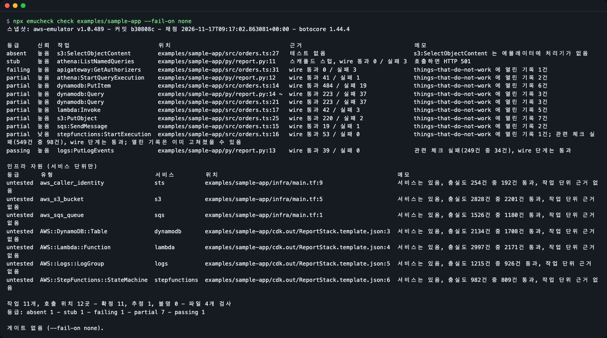
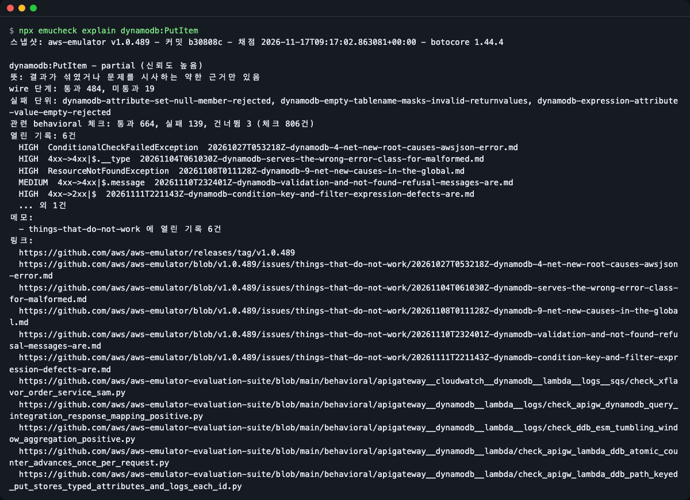
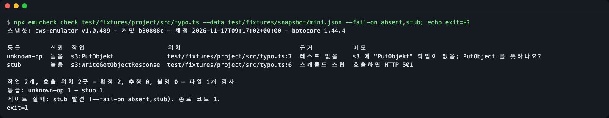
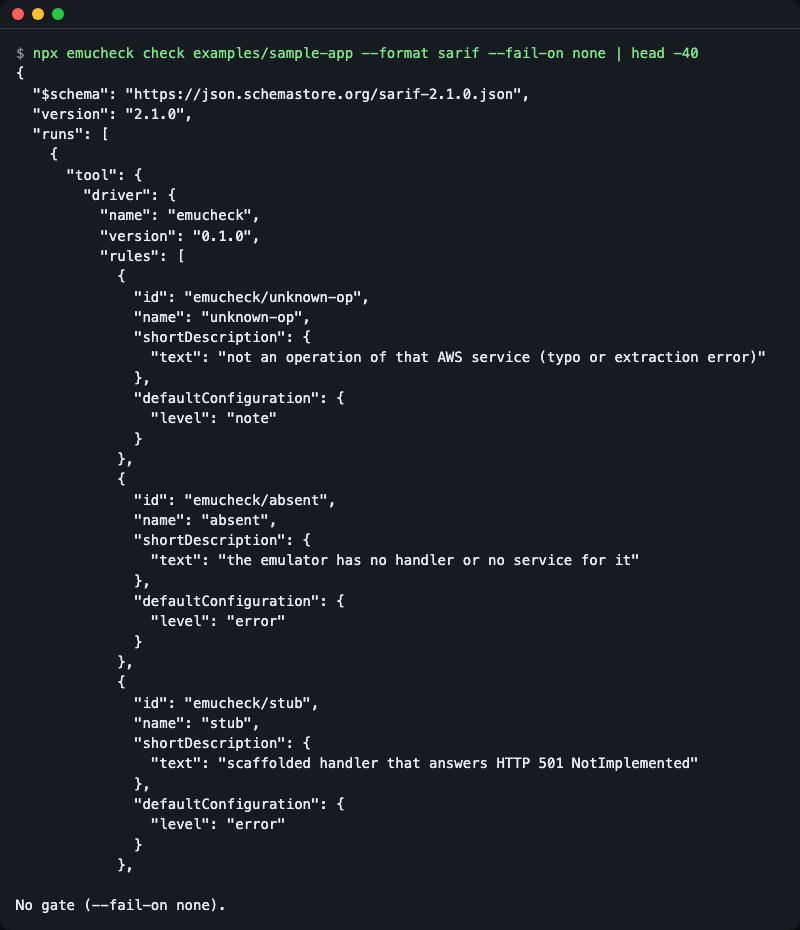
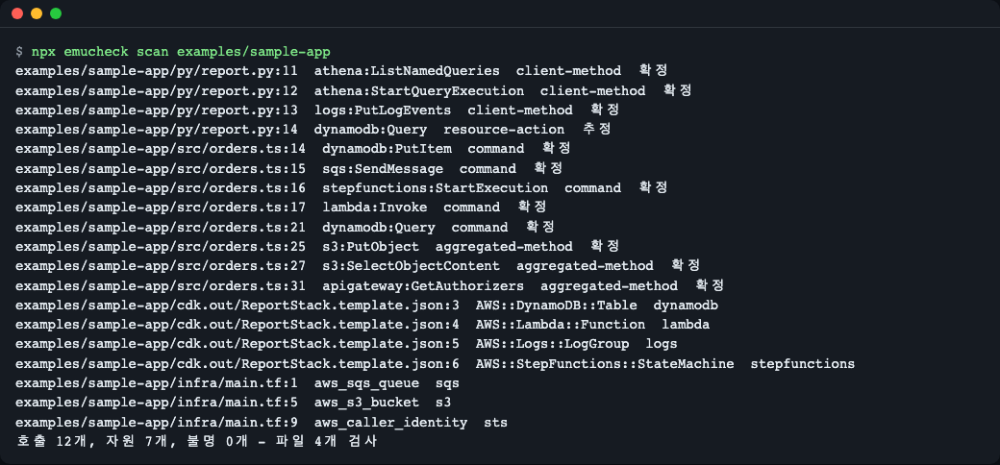
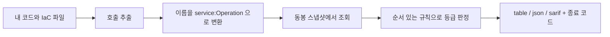

# emucheck

[English](README.md) | **한국어**

emucheck 는 내 AWS 코드를 로컬 [aws-emulator](https://github.com/aws/aws-emulator) 로 돌려 보려는 프로젝트를 위한 사전 점검 도구입니다. Node.js·Python·IaC 파일을 훑어 실제로 부르는 AWS API 호출을 찾고, 에뮬레이터를 띄우기 전에 공개된 근거(고정 스냅샷)로 호출마다 등급(absent, stub, failing, partial, passing)을 매깁니다. 비공식 도구이며 AWS 와 관련이 없습니다.


*`emucheck check` 는 호출 위치마다 등급, 신뢰도, 테스트 근거, 메모를 보여 줍니다. 줄 번호 뒤 `~` 는 추정한 호출입니다.*

## 이런 분께

- 로컬 AWS 에뮬레이터로 테스트·CI 를 돌리려는데, 설정에 시간을 쓰기 전에 무엇이 안 되는지 알고 싶은 분
- AWS SDK for JavaScript v3 또는 boto3 를 쓰고, CloudFormation·CDK 출력·Terraform 을 함께 쓰는 분
- 에뮬레이터가 지원하지 않는 API 를 새로 부르는 풀 리퀘스트를 CI 에서 막고 싶은 분

## 설치

Node.js 22.18 이상(또는 24.11 이상)이 필요합니다. 실행에 AWS 계정·API 키·네트워크는 필요 없습니다.

```bash
# Node.js: https://nodejs.org (macOS: brew install node, Debian/Ubuntu: 배포판 패키지는 22.18보다 낮을 수 있으니 nodejs.org 바이너리나 nvm 사용)
git clone https://github.com/LeeGyeongPil/emucheck && cd emucheck
npm install && npm run build
node dist/cli.js --version
```

패키지가 npm 에 올라가면 clone 없이 `npx emucheck check .` 로도 실행할 수 있습니다. 아래 예시는 새로 clone 한 상태에서 바로 되도록 `node dist/cli.js` 를 씁니다. `emucheck` 와 `node dist/cli.js` 는 같은 프로그램입니다.

## 빠르게 시작하기

```bash
npm start
```

`npm start` 는 빌드한 뒤 동봉된 `examples/sample-app`(Node·Python 코드, CDK 템플릿, Terraform 파일이 든 작은 앱)을 점검합니다. 실제 출력입니다(영어 화면, `--lang ko` 또는 한국어 환경이면 한국어).

```text
Snapshot: aws-emulator v1.0.489 - commit b30808c - scored 2026-11-17T09:17:02.863081+00:00 - botocore 1.44.4

GRADE    CONF  OPERATION                     WHERE                                  EVIDENCE                               NOTE
absent   high  s3:SelectObjectContent        examples/sample-app/src/orders.ts:27   no tests                               s3:SelectObjectContent has no handler in the emulator
stub     high  athena:ListNamedQueries       examples/sample-app/py/report.py:11    scaffolded stub, wire 0 pass / 3 fail  calls get HTTP 501
failing  high  apigateway:GetAuthorizers     examples/sample-app/src/orders.ts:31   wire 0 pass / 3 fail                   1 open record(s) in things-that-do-not-work
partial  high  dynamodb:PutItem              examples/sample-app/src/orders.ts:14   wire 484 pass / 19 fail                6 open record(s) in things-that-do-not-work
...
11 operations at 12 call sites - 11 certain, 1 inferred, 0 unresolved - 4 files scanned
Grades: absent 1 - stub 1 - failing 1 - partial 7 - passing 1
No gate (--fail-on none).
```

(일부 행은 줄였습니다. 실제 출력에는 인프라 자원 표가 이어집니다.) 읽는 법: `orders.ts:27` 의 `s3:SelectObjectContent` 는 `absent` 입니다. 에뮬레이터에 처리기가 아예 없어서 그 코드 경로는 로컬에서 동작할 수 없다는 뜻입니다. `dynamodb:PutItem` 은 `partial` 입니다. 에뮬레이터가 처리하긴 하지만 wire 단계 테스트 503개 중 19개가 통과하지 못합니다.

## 사용법

| 명령·옵션 | 하는 일 | 예 |
|---|---|---|
| `check [경로...]` | 모든 AWS 호출과 IaC 자원에 등급 매기기 (기본 경로 `.`) | `emucheck check src infra` |
| `scan [경로...]` | 등급 없이 찾은 호출과 자원만 나열 | `emucheck scan .` |
| `explain <svc:Op>` | 작업 하나의 근거를 모두 표시 | `emucheck explain dynamodb:PutItem` |
| `data-info` | 동봉된 에뮬레이터 스냅샷 정보 표시 | `emucheck data-info` |
| `--format table\|json\|sarif` | 출력 형식 (`scan` 은 table·json) | `--format sarif` |
| `--fail-on <등급>\|none` | 나열한 등급이 하나라도 있으면 종료 코드 1 (기본 `absent,stub`) | `--fail-on absent,stub,failing` |
| `--show-unresolved` | 작업을 알 수 없는 호출 목록 표시 | |
| `--ignore <디렉터리>` | 이 이름의 디렉터리 건너뛰기 (반복 가능) | `--ignore vendor` |
| `--data <파일>` | 다른 스냅샷 파일 사용 | `--data my-snapshot.json` |
| `--lang en\|ko` | 출력 언어 | `--lang ko` |

종료 코드: 0 정상, 1 `--fail-on` 등급 발견, 2 사용법·입력 오류.

### 이 호출은 왜 이 등급인가

```bash
node dist/cli.js explain dynamodb:PutItem
```


*`explain` 은 wire 단계, 관련 behavioral 체크, 열린 이슈 기록, 근거 링크를 보여 줍니다.*

wire 단계는 바로 이 작업에 대한 에뮬레이터의 실제 HTTP 응답을 비교하는 테스트입니다. behavioral 체크는 여러 작업을 건드리는 더 큰 시나리오입니다. emucheck 는 wire 단계를 먼저 믿습니다(등급이 정해지는 방식 참고).

### 미지원 호출이 있으면 CI 실패시키기

```bash
node dist/cli.js check test/fixtures/project/src/typo.ts --data test/fixtures/snapshot/mini.json --fail-on absent,stub 2>&1; echo exit=$?
```


*마지막 줄들에 게이트 메시지와 종료 코드가 보입니다. 결과가 바뀌지 않도록 작은 고정 스냅샷으로 실행했습니다.*

위 명령의 실제 출력입니다(영어 화면).

```text
Snapshot: aws-emulator v1.0.489 - commit b30808c - scored 2026-11-17T09:17:02+00:00 - botocore 1.44.4

GRADE       CONF  OPERATION                  WHERE                                EVIDENCE         NOTE
unknown-op  high  s3:PutObjekt               test/fixtures/project/src/typo.ts:7  no tests         s3 has no operation "PutObjekt"; did you mean PutObject?
stub        high  s3:WriteGetObjectResponse  test/fixtures/project/src/typo.ts:6  scaffolded stub  calls get HTTP 501

2 operations at 2 call sites - 2 certain, 0 inferred, 0 unresolved - 1 files scanned
Grades: unknown-op 1 - stub 1
Gate failed: found stub (--fail-on absent,stub). Exit code 1.
exit=1
```

CI 단계에 `npx emucheck check . --fail-on absent,stub` 를 넣으세요. 게이트 메시지는 stderr 로 나오고 종료 코드는 1 입니다.

### 코드 스캐닝용 SARIF

```bash
node dist/cli.js check examples/sample-app --format sarif --fail-on none > emucheck.sarif
```


*SARIF 2.1.0 출력은 GitHub 코드 스캐닝에 올릴 수 있습니다. 시각 정보가 없어서 같은 입력이면 바이트까지 같습니다.*

### 찾은 것만 나열하기

```bash
node dist/cli.js scan examples/sample-app
```


*`scan` 은 각 호출을 어떻게 찾았는지(`client-method`, `command`, `resource-action` 등)와 `certain`(확정)·`inferred`(추정) 여부를 보여 줍니다.*

## 설정

두 설정 모두 선택입니다([.env.example](.env.example) 참고).

| 설정 | 뜻 | 기본값 |
|---|---|---|
| `EMUCHECK_LANG` | 출력 언어 `en` 또는 `ko`. 우선순위: `--lang`, `EMUCHECK_LANG`, `LC_ALL`, `LC_MESSAGES`, `LANG`. 값이 `ko` 로 시작하면 한국어, 그 밖에는 영어. | 영어 |
| `EMUCHECK_DATA` | 다른 스냅샷 파일 경로 (`--data` 가 우선). | 동봉 스냅샷 |

JSON·SARIF 의 필드와 등급 이름은 언어와 무관합니다.

```bash
node dist/cli.js check examples/sample-app --lang ko --fail-on none
```

동봉 데이터는 고정된 스냅샷입니다. [데이터 스냅샷](#데이터-스냅샷)을 참고하세요.

## 무엇을 찾아내나

| 입력 | 읽는 것 | 예 |
|---|---|---|
| JavaScript / TypeScript (`.js .mjs .cjs .jsx .ts .tsx`, 데코레이터 허용) | AWS SDK for JavaScript v3: `client.send(new XCommand())`, 통합 클라이언트 메서드(`s3.putObject()`), `paginateX`, `lib-dynamodb`·`lib-storage` 도우미 | `ddb.send(new PutItemCommand(...))` 은 `dynamodb:PutItem` |
| Python (`.py`) | boto3: `client("s3").put_object()`, 페이지네이터, 손으로 만든 리소스 동작 일부(예: DynamoDB `Table`) | `sqs.send_message(...)` 은 `sqs:SendMessage` |
| CloudFormation / CDK 출력 (`.json .yaml .yml`, `cdk.out`) | `AWS::Lambda::Function` 같은 리소스 종류 | 서비스 단위로 판정 |
| Terraform (`.tf`) | `aws_*` 리소스 종류 | 서비스 단위로 판정 |

찾지 못하는 것(`scan` 과 `--show-unresolved` 로 무엇을 찾았는지 확인하세요):

- 실행 중에 계산하는 작업 이름(`getattr(client, name)`, 동적 메서드 이름), 다른 파일에 정의된 클라이언트나 래퍼.
- AWS SDK for JavaScript v2, 그리고 위 형식 밖의 언어(Go, Java 등).
- Python f-string 안에 쓴 호출.
- 5 MB 를 넘는 파일과 읽을 수 없거나 일부만 해석된 템플릿: 건너뛰며, 보고서 끝에 `분석하지 못하고 건너뛴 파일 1개:` 같은 줄로 하나씩 알려 줍니다.
- `node_modules` 같은 이름의 디렉터리는 건너뜁니다. 더 건너뛰려면 `--ignore` 를 쓰세요.

## 동작 원리



1. **호출 추출**: JavaScript·TypeScript 는 `@babel/parser` 로, Python 은 내장 토크나이저로 읽고, CloudFormation(JSON/YAML, `cdk.out` 포함)과 Terraform 에서는 자원 종류를 읽습니다.
2. **이름 변환**: `PutItemCommand` 와 `put_item` 은 둘 다 `dynamodb:PutItem` 이 되고 botocore 의 작업 목록과 대조합니다. botocore 에 없는 이름은 `unknown-op` 으로 알리거나 무시해서 오탐을 줄입니다.
3. **조회**: 스냅샷에는 테스트 점수, evaluation-suite 매니페스트, 열린 이슈 기록, 스캐폴드 스텁 표시, 에뮬레이터 서비스별 처리기 목록이 들어 있습니다.
4. **판정**: 규칙을 순서대로 적용하고 처음 맞는 것이 이깁니다.

### 등급이 정해지는 방식

| 등급 | 뜻 |
|---|---|
| `unknown-op` | 그 AWS 서비스에 없는 작업(오타 또는 추출 오류) |
| `absent` | 에뮬레이터에 처리기나 서비스가 없음 |
| `stub` | 처리기 파일이 스캐폴드뿐이라 호출하면 HTTP 501 |
| `failing` | 이 작업의 wire 단계 테스트가 실패 |
| `partial` | 결과가 섞였거나 문제를 시사하는 약한 근거만 있음 |
| `untested` | 작업 단위 근거 없음 (IaC 자원은 서비스 단위로만 판정) |
| `passing` | wire 단계 테스트 통과 |

중요한 선택이 둘 있습니다. 첫째, wire 단계가 behavioral 집계보다 우선합니다. `dynamodb:PutItem` 과 관련된 behavioral 체크 806건은 통과 664 / 실패 139(건너뜀 3)이지만 자기 wire 단계는 통과 484 / 미통과 19 입니다. 시나리오 실패를 그것이 건드린 모든 작업에 나눠 붙이면 과잉 경보가 납니다. 둘째, `absent` 는 `untested` 와 따로 둡니다. 테스트 점수가 없는 호출이 `s3:SelectObjectContent` 처럼 아예 없는 것일 수도 있기 때문에 스냅샷에 서비스별 처리기 목록을 넣어 둡니다.

## 데이터 스냅샷

등급은 패키지에 동봉된 스냅샷 파일(`data/aws-emulator-v1.0.489.json.gz`)에서 나옵니다. 이름·개수·파일 경로·심각도만 들어 있고 소스 코드나 문서 본문은 없습니다. `node dist/cli.js data-info` 의 실제 출력입니다(영어 화면).

```text
Bundled emulator data snapshot
aws-emulator release: v1.0.489
scores commit: b30808c9e1b2a6d025e5a0a9af64946404ff0905
scored at: 2026-11-17T09:17:02.863081+00:00
evaluation-suite commit: 4df2823bafface2ada35f482c07ff6668cc078e1
botocore: 1.44.4
built at: 2026-11-17T10:59:45.018Z
services: 439 (433 in the emulator), operations with evidence: 17861, stubs: 7259
test units: 43548, unparsed issue files: 239
age: 0 days
```

(`data-info` 는 이어서 근거 링크를 나열합니다.)

| 출처 | 고정 버전 | 라이선스 |
|---|---|---|
| [aws/aws-emulator](https://github.com/aws/aws-emulator): 테스트 점수, 열린 이슈 기록, 처리기 파일 이름 | v1.0.489, 커밋 b30808c | CC0-1.0 |
| [aws/aws-emulator-evaluation-suite](https://github.com/aws/aws-emulator-evaluation-suite): 테스트 매니페스트 | 커밋 4df2823b | CC0-1.0 |
| [botocore](https://pypi.org/project/botocore/): 서비스·작업 이름 | 1.44.4 | Apache-2.0 |

전체 출처 표기는 [data/NOTICE](data/NOTICE) 에 있습니다. 스냅샷이 14일보다 오래되면 `check` 가 "결과는 그 시점 기준이며 최신 에뮬레이터 릴리스와 다를 수 있다"는 경고를 냅니다.

clone 에서 더 새로운 스냅샷을 만들려면(네트워크, `git`, `unzip` 필요. 이 스크립트는 npm 패키지에 들어 있지 않습니다):

```bash
npm run build
node scripts/fetch-data.mjs --release v1.0.489 --out my-snapshot.json.gz
node dist/cli.js check . --data my-snapshot.json.gz
```

`--release` 를 빼면 최신 릴리스를 씁니다. 스크립트는 릴리스마다 작업 폴더를 따로 두고, 끝에 쓸 `--data` 명령을 출력합니다. `--data` 를 주거나 `EMUCHECK_DATA` 를 설정하기 전까지 CLI 는 동봉 스냅샷을 계속 읽습니다.

## 라이브러리 API

같은 엔진을 스크립트나 다른 도구에서 쓸 수 있게 내보냅니다(공개 후 `npm install emucheck`, clone 에서는 `dist/index.js` 에서 import). 저장소 루트에서 실행한 실제 예제입니다.

```js
import { loadSnapshot, scan, check, explain, failsGate, renderJson } from "emucheck";

const snapshot = loadSnapshot(); // bundled snapshot, or loadSnapshot("my-snapshot.json.gz")
const result = await scan(["examples/sample-app"], { snapshot });
const report = check(result, snapshot);

console.log(report.findings.length, "findings");                  // 11 findings
console.log(failsGate(report, ["absent", "stub"]));               // true
console.log(explain("s3:SelectObjectContent", snapshot).grade);   // absent
console.log(renderJson(report).slice(0, 40));
```

| 내보내기 | 용도 |
|---|---|
| `loadSnapshot(path?)` | 동봉 스냅샷이나 파일을 읽음. 실패하면 해결 힌트가 든 `SnapshotFormatError` |
| `scan(paths, options?)` | 호출과 자원을 찾음(`ScanResult`). 없는 경로면 `UsageError` |
| `check(result, snapshot)` | 스캔 결과에 등급을 매김(`Report`) |
| `explain("svc:Op", snapshot)` | 작업 하나의 모든 근거 |
| `failsGate(report, grades)` | `--fail-on` 과 같은 규칙 |
| `renderJson`, `renderSarif(report, lang)`, `renderTable(report, { lang, showUnresolved })` | 출력 형식 |
| `buildSnapshot`, `xformName`, `resolveLang`, `GRADE_ORDER` | 스냅샷 빌더와 도우미 |

`Report`, `Finding`, `Grade`, `Snapshot` 같은 타입도 내보냅니다. 다른 언어에서 결과만 필요하면 `--format json` 출력(`tool`, `version`, `snapshot`, `summary`, `skipped`, `findings`, `resources`, `unresolved`)을 쓰세요.

## 언제 쓰나

- 잘 맞는 때: 에뮬레이터 도입 전에 한 번 훑어볼 때, 그리고 풀 리퀘스트마다 새 SDK 호출이 지원되는지 확인할 때. 같은 입력과 같은 스냅샷이면 출력이 같습니다.
- 대체재가 아닌 때: 등급은 공개 테스트 근거에서 나오며 내 요청을 직접 보낸 결과가 아닙니다. 등급은 보장이 아니라 살펴볼 경고로 보세요.
- 함께 볼 도구: [moto](https://github.com/getmoto/moto)와 [LocalStack 문서](https://docs.localstack.cloud/)는 서비스별 커버리지를 공개합니다. [aws-emulator](https://github.com/aws/aws-emulator) 자체에도 프로젝트 점검 절차 문서가 있습니다.

## 한계와 FAQ

**AWS 공식 도구인가요?** 아닙니다. 비공식이며 AWS 와 관련이 없고 AWS 의 보증을 받은 것도 아닙니다.

**`passing` 이면 내 코드가 에뮬레이터에서 동작한다는 뜻인가요?** 아닙니다. 등급은 작업별 공개 테스트 근거를 요약한 것이며 내 요청·입력·데이터로 시험한 결과가 아닙니다.

**스냅샷끼리 결과를 비교해도 되나요?** 따로 잰 측정값으로 보세요. 에뮬레이터의 채점 방식이 릴리스마다 바뀔 수 있어서, 두 스냅샷 사이에 등급이 달라져도 내 코드가 아니라 채점 때문일 수 있습니다. 같은 스냅샷으로 돌린 결과끼리 비교하세요.

**오래된 열린 기록이 왜 보이나요?** 열린 이슈 기록은 고정한 릴리스 시점 그대로 읽습니다. 그 뒤에 고쳐졌을 수 있고, 그런 경우를 `open record may be stale` 메모로 표시합니다. `explain` 과 링크로 확인하세요.

**인프라 파일은 왜 서비스 단위로만 판정하나요?** CloudFormation·Terraform 은 배포가 부를 API 호출이 아니라 리소스 종류를 적습니다. 그래서 쓸 수 있는 가장 좋은 근거가 서비스 전체 통과율이고, 등급은 `untested` 입니다.

**내 코드를 실행하거나 AWS 를 호출하나요?** 아닙니다. 파일을 텍스트로만 읽습니다. `check` 경로는 네트워크를 쓰지 않고 프로젝트 코드도 실행하지 않습니다. 공개 데이터를 내려받는 것은 `scripts/fetch-data.mjs`(GitHub, PyPI)뿐입니다.

## 자주 겪는 문제

| 증상 | 원인 | 해결 |
|---|---|---|
| `Path not found` 와 종료 코드 2 | 경로가 없음 | 존재하는 파일이나 디렉터리를 주세요. 예: `emucheck check .` |
| `unresolved`(불명) 개수가 0 보다 큼 | 작업 이름을 실행 중에 계산함(`getattr`, 동적 메서드 이름) | `--show-unresolved` 로 목록을 보고 직접 확인 |
| 내 컴퓨터에서 출력이 한국어로 나옴 | `LANG`·`LC_ALL` 이 `ko` 로 시작 | `--lang en` 또는 `EMUCHECK_LANG=en` |
| CI 에서 종료 코드 1 | `--fail-on` 에 있는 등급이 발견됨 | 호출을 고치거나 목록을 줄이세요. 예: `--fail-on absent` |
| 보고서에 있어야 할 호출이 없음 | 동적 코드이거나 emucheck 가 읽지 못하는 SDK 사용 방식 | `scan` 으로 찾은 것을 확인하고, 작은 예제와 함께 이슈로 알려 주세요 |
| 결과가 오래된 것 같음 | 동봉 스냅샷은 고정된 릴리스 | `data-info` 로 날짜 확인. clone 에서 `node scripts/fetch-data.mjs` 로 새로 만들고 `--data` 로 지정([데이터 스냅샷](#데이터-스냅샷) 참고) |
| 끝에 `분석하지 못하고 건너뛴 파일 N개` | 파일이 5 MB 초과이거나 읽을 수 없거나 템플릿을 끝까지 해석하지 못함 | 표시된 이유를 보고 파일을 나누거나 고친 뒤 다시 실행 |

## 개발·기여

```bash
npm install
npm test
```

오프라인 테스트 144개(11개 파일)가 통과합니다. 버그·제안은 이슈로 남겨 주세요. 변경 기록은 [CHANGELOG.md](CHANGELOG.md).

## 라이선스

emucheck 자체는 MIT 입니다. 동봉 스냅샷은 [aws/aws-emulator](https://github.com/aws/aws-emulator)·[aws/aws-emulator-evaluation-suite](https://github.com/aws/aws-emulator-evaluation-suite)(둘 다 CC0-1.0)의 공개 데이터와 botocore(Apache-2.0)에서 만들었습니다. 자세한 내용은 [data/NOTICE](data/NOTICE) 에 있습니다.
