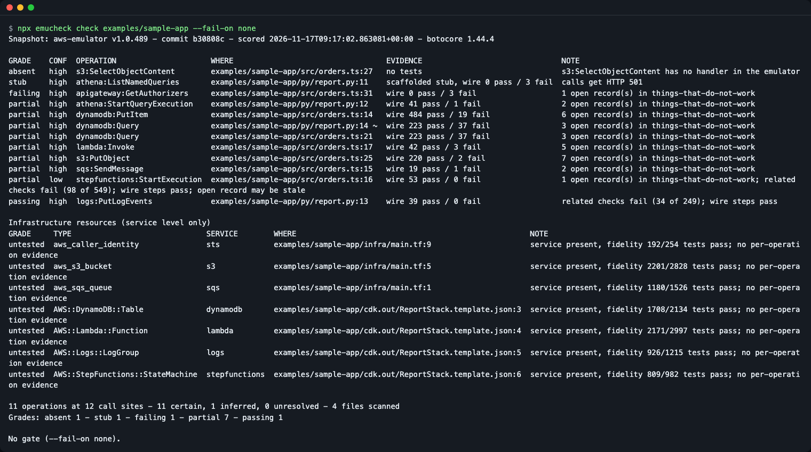
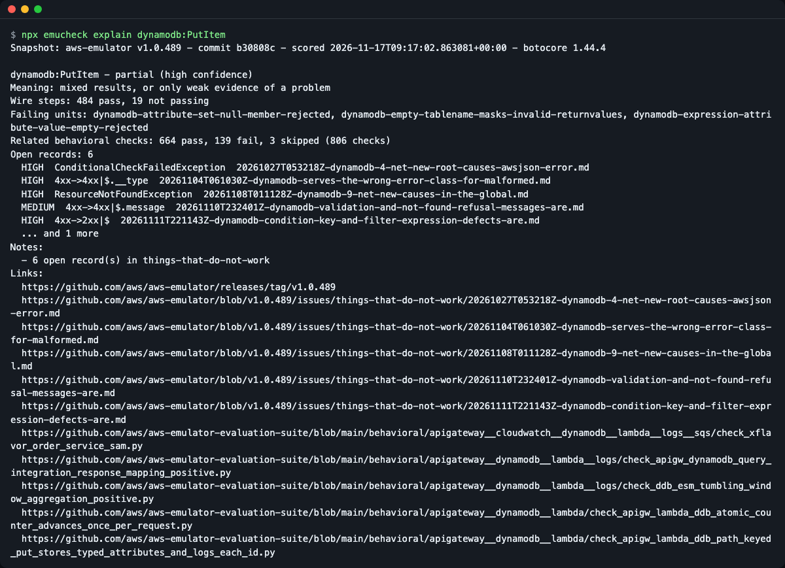
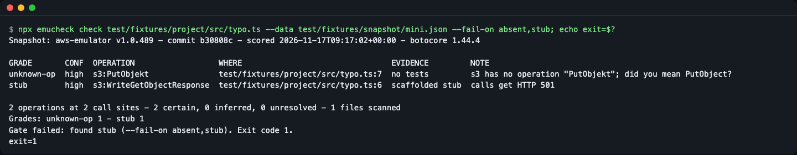
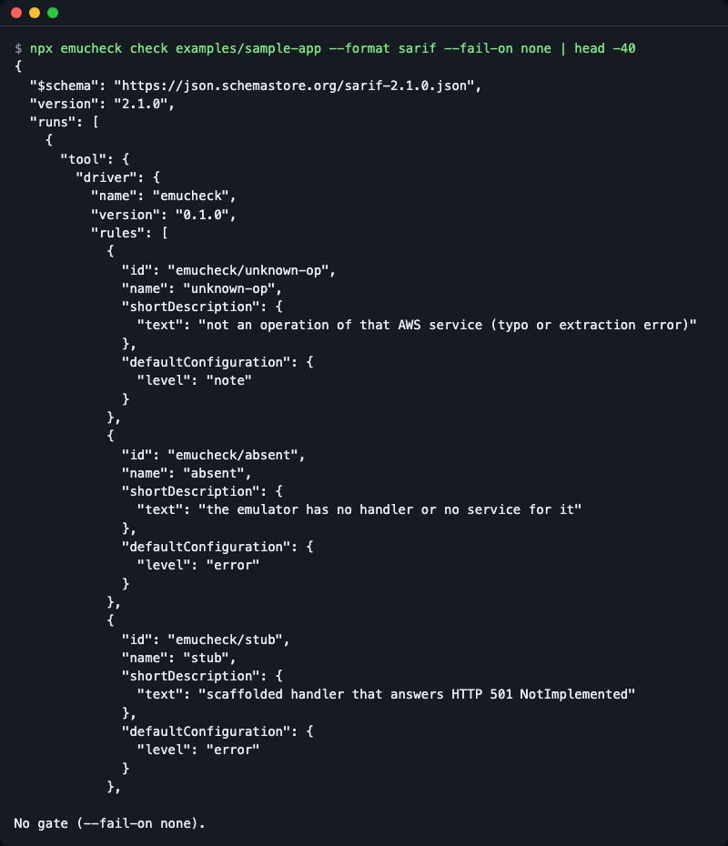
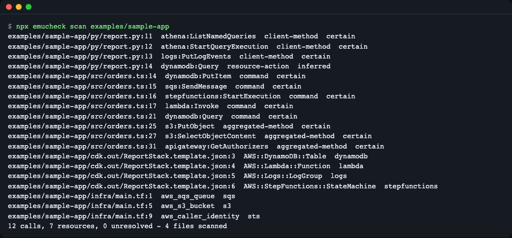
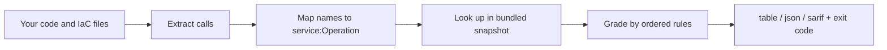

# emucheck

**English** | [한국어](README.ko.md)

emucheck is a preflight check for projects that want to run their AWS code against the local [aws-emulator](https://github.com/aws/aws-emulator). It scans your Node.js, Python and IaC files, finds the AWS API calls you actually make, and grades each one (absent, stub, failing, partial, passing) from pinned public evidence, before you start the emulator. It is unofficial and not affiliated with AWS.


*`emucheck check` lists each call site with a grade, a confidence, the test evidence and a note. The `~` after a line number means the call was inferred.*

## Who is it for

- You want to run tests or CI against a local AWS emulator and need to know what will not work before you spend time on setup.
- You use AWS SDK for JavaScript v3 or boto3, and maybe CloudFormation, CDK output or Terraform.
- You want a CI step that fails a pull request when a new call hits an API the emulator does not serve.

## Install

Requires Node.js 22.18 or newer (or 24.11+). No AWS account, API key or network access is needed to run it.

```bash
# Node.js: https://nodejs.org (macOS: brew install node, Debian/Ubuntu: distro packages may be older than 22.18, use the nodejs.org binary or nvm)
git clone https://github.com/LeeGyeongPil/emucheck && cd emucheck
npm install && npm run build
node dist/cli.js --version
```

Once the package is on npm you can also run it without cloning: `npx emucheck check .`. The examples below use `node dist/cli.js` so they work from a fresh clone; `emucheck` and `node dist/cli.js` are the same program.

## Quick start

```bash
npm start
```

`npm start` builds the project and checks the bundled `examples/sample-app` (a small Node plus Python app with a CDK template and a Terraform file). Real output:

```text
Snapshot: aws-emulator v1.0.489 - commit b30808c - scored 2026-11-17T09:17:02.863081+00:00 - botocore 1.44.4

GRADE    CONF  OPERATION                     WHERE                                  EVIDENCE                               NOTE
absent   high  s3:SelectObjectContent        examples/sample-app/src/orders.ts:27   no tests                               s3:SelectObjectContent has no handler in the emulator
stub     high  athena:ListNamedQueries       examples/sample-app/py/report.py:11    scaffolded stub, wire 0 pass / 3 fail  calls get HTTP 501
failing  high  apigateway:GetAuthorizers     examples/sample-app/src/orders.ts:31   wire 0 pass / 3 fail                   1 open record(s) in things-that-do-not-work
partial  high  dynamodb:PutItem              examples/sample-app/src/orders.ts:14   wire 484 pass / 19 fail                6 open record(s) in things-that-do-not-work
...
11 operations at 12 call sites - 11 certain, 1 inferred, 0 unresolved - 4 files scanned
Grades: absent 1 - stub 1 - failing 1 - partial 7 - passing 1
No gate (--fail-on none).
```

(Some rows are cut here; a second table for infrastructure resources follows in the real output.) How to read it: `s3:SelectObjectContent` at `orders.ts:27` is graded `absent`, meaning the emulator has no handler for it at all, so that code path cannot work locally. `dynamodb:PutItem` is `partial`: the emulator serves it, but 19 of its 503 wire-level test steps do not pass.

## Usage

| Command / option | What it does | Example |
|---|---|---|
| `check [paths...]` | Grade every AWS call and IaC resource (default path `.`) | `emucheck check src infra` |
| `scan [paths...]` | List the calls and resources found, without grading | `emucheck scan .` |
| `explain <svc:Op>` | Show all evidence for one operation | `emucheck explain dynamodb:PutItem` |
| `data-info` | Show which emulator snapshot is bundled | `emucheck data-info` |
| `--format table\|json\|sarif` | Output format (`scan`: table or json) | `--format sarif` |
| `--fail-on <grades>\|none` | Exit code 1 if any listed grade is found (default `absent,stub`) | `--fail-on absent,stub,failing` |
| `--show-unresolved` | List calls whose operation could not be determined | |
| `--ignore <dir>` | Skip directories with this name (repeatable) | `--ignore vendor` |
| `--data <file>` | Use another snapshot file | `--data my-snapshot.json` |
| `--lang en\|ko` | Output language | `--lang ko` |

Exit codes: 0 ok, 1 a `--fail-on` grade was found, 2 usage or input error.

### Why is this call graded this way

```bash
node dist/cli.js explain dynamodb:PutItem
```


*`explain` shows wire steps, related behavioral checks, open issue records and links to the evidence.*

Wire steps are tests that compare the emulator's real HTTP responses for exactly this operation. Behavioral checks are larger scenarios that touch several operations. emucheck trusts wire steps first (see How grades are decided).

### Fail CI on unsupported calls

```bash
node dist/cli.js check test/fixtures/project/src/typo.ts --data test/fixtures/snapshot/mini.json --fail-on absent,stub 2>&1; echo exit=$?
```


*The last lines show the gate message and the exit code. This run uses a small fixed snapshot so the result never changes.*

Real output of that command (English screen):

```text
Snapshot: aws-emulator v1.0.489 - commit b30808c - scored 2026-11-17T09:17:02+00:00 - botocore 1.44.4

GRADE       CONF  OPERATION                  WHERE                                EVIDENCE         NOTE
unknown-op  high  s3:PutObjekt               test/fixtures/project/src/typo.ts:7  no tests         s3 has no operation "PutObjekt"; did you mean PutObject?
stub        high  s3:WriteGetObjectResponse  test/fixtures/project/src/typo.ts:6  scaffolded stub  calls get HTTP 501

2 operations at 2 call sites - 2 certain, 0 inferred, 0 unresolved - 1 files scanned
Grades: unknown-op 1 - stub 1
Gate failed: found stub (--fail-on absent,stub). Exit code 1.
exit=1
```

Put `npx emucheck check . --fail-on absent,stub` in a CI step. The gate message goes to stderr and the exit code is 1.

### SARIF for code scanning

```bash
node dist/cli.js check examples/sample-app --format sarif --fail-on none > emucheck.sarif
```


*SARIF 2.1.0 output can be uploaded to GitHub code scanning. It has no timestamps, so the same input gives the same bytes.*

### Just list what was found

```bash
node dist/cli.js scan examples/sample-app
```


*`scan` shows how each call was found (`client-method`, `command`, `resource-action` ...) and whether it is `certain` or `inferred`.*

## Configuration

Both settings are optional (see [.env.example](.env.example)):

| Setting | Meaning | Default |
|---|---|---|
| `EMUCHECK_LANG` | Output language, `en` or `ko`. Order: `--lang`, `EMUCHECK_LANG`, `LC_ALL`, `LC_MESSAGES`, `LANG`. A value starting with `ko` gives Korean, anything else English. | English |
| `EMUCHECK_DATA` | Path to another snapshot file (`--data` wins). | bundled snapshot |

JSON and SARIF fields and grade names do not change with the language.

```bash
node dist/cli.js check examples/sample-app --lang ko --fail-on none
```

The bundled data is a fixed snapshot; see [Data snapshot](#data-snapshot).

## What it detects

| Input | What is read | Example |
|---|---|---|
| JavaScript / TypeScript (`.js .mjs .cjs .jsx .ts .tsx`, decorators allowed) | AWS SDK for JavaScript v3: `client.send(new XCommand())`, aggregated client methods (`s3.putObject()`), `paginateX`, `lib-dynamodb` and `lib-storage` helpers | `ddb.send(new PutItemCommand(...))` is `dynamodb:PutItem` |
| Python (`.py`) | boto3: `client("s3").put_object()`, paginators, and a hand-written subset of resource actions (for example DynamoDB `Table`) | `sqs.send_message(...)` is `sqs:SendMessage` |
| CloudFormation / CDK output (`.json .yaml .yml`, `cdk.out`) | Resource types such as `AWS::Lambda::Function` | graded at service level |
| Terraform (`.tf`) | `aws_*` resource types | graded at service level |

Not caught (use `scan` and `--show-unresolved` to see what was found):

- Operation names computed at runtime (`getattr(client, name)`, dynamic method names) and clients or wrappers defined in another file.
- AWS SDK for JavaScript v2, and languages other than JavaScript/TypeScript, Python and the IaC formats above (Go, Java, ...).
- Calls written inside Python f-strings.
- Files over 5 MB, and unreadable or incompletely parsed templates: they are skipped, and the report ends with a line such as `Skipped 1 file(s) that were not analyzed:` naming each one.
- Directories named `node_modules` and similar are skipped; add more with `--ignore`.

## How it works



1. **Extract calls**: JavaScript and TypeScript are parsed with `@babel/parser`; Python with a small built-in tokenizer; CloudFormation (JSON/YAML, including `cdk.out`) and Terraform for resource types.
2. **Map names**: `PutItemCommand` and `put_item` both become `dynamodb:PutItem`, checked against botocore's operation list. Names botocore does not know are reported as `unknown-op` or ignored, so there are few false alarms.
3. **Look up**: the snapshot holds test scores, the evaluation-suite manifest, open issue records, scaffolded stub markers and each emulator service's list of handlers.
4. **Grade**: rules run in order and the first match wins.

### How grades are decided

| Grade | Meaning |
|---|---|
| `unknown-op` | Not an operation of that AWS service (typo or extraction error) |
| `absent` | The emulator has no handler or no service for it |
| `stub` | The handler file is a scaffold; calls get HTTP 501 |
| `failing` | Wire-step tests for this operation fail |
| `partial` | Mixed results, or only weak evidence of a problem |
| `untested` | No per-operation evidence (IaC resources are graded at service level only) |
| `passing` | Wire-step tests pass |

Two choices matter. First, wire steps rank above behavioral aggregates: for `dynamodb:PutItem` the 806 related behavioral checks say 664 pass / 139 fail (3 skipped), but its own wire steps say 484 pass / 19 not passing, so spreading scenario failures over every operation they touch would raise false alarms. Second, `absent` is separate from `untested`: a call with no test score can still be missing entirely, as `s3:SelectObjectContent` is, so the snapshot stores each service's handler list.

## Data snapshot

The grades come from a snapshot file bundled in the package (`data/aws-emulator-v1.0.489.json.gz`). It holds only names, counts, file paths and severities, not source code or documentation text. Real output of `node dist/cli.js data-info`:

```text
Bundled emulator data snapshot
aws-emulator release: v1.0.489
scores commit: b30808c9e1b2a6d025e5a0a9af64946404ff0905
scored at: 2026-11-17T09:17:02.863081+00:00
evaluation-suite commit: 4df2823bafface2ada35f482c07ff6668cc078e1
botocore: 1.44.4
built at: 2026-11-17T10:59:45.018Z
services: 439 (433 in the emulator), operations with evidence: 17861, stubs: 7259
test units: 43548, unparsed issue files: 239
age: 0 days
```

(`data-info` goes on to list the evidence links.)

| Source | Pinned to | License |
|---|---|---|
| [aws/aws-emulator](https://github.com/aws/aws-emulator): test scores, open issue records, handler file names | v1.0.489, commit b30808c | CC0-1.0 |
| [aws/aws-emulator-evaluation-suite](https://github.com/aws/aws-emulator-evaluation-suite): test manifest | commit 4df2823b | CC0-1.0 |
| [botocore](https://pypi.org/project/botocore/): service and operation names | 1.44.4 | Apache-2.0 |

The full attribution is in [data/NOTICE](data/NOTICE). When the snapshot is more than 14 days old, `check` prints a warning that results describe that moment, not the newest emulator release.

To build a newer snapshot from a clone (needs network access, `git` and `unzip`; the script is not part of the npm package):

```bash
npm run build
node scripts/fetch-data.mjs --release v1.0.489 --out my-snapshot.json.gz
node dist/cli.js check . --data my-snapshot.json.gz
```

Leave out `--release` to use the newest release. The script keeps one work folder per release and prints the `--data` command to use at the end; the CLI keeps reading the bundled snapshot until you pass `--data` or set `EMUCHECK_DATA`.

## Library API

The same engine is exported for scripts and other tools (`npm install emucheck` once published; in a clone, import from `dist/index.js`). Real example, run from the repository root:

```js
import { loadSnapshot, scan, check, explain, failsGate, renderJson } from "emucheck";

const snapshot = loadSnapshot(); // bundled snapshot, or loadSnapshot("my-snapshot.json.gz")
const result = await scan(["examples/sample-app"], { snapshot });
const report = check(result, snapshot);

console.log(report.findings.length, "findings");                  // 11 findings
console.log(failsGate(report, ["absent", "stub"]));               // true
console.log(explain("s3:SelectObjectContent", snapshot).grade);   // absent
console.log(renderJson(report).slice(0, 40));
```

| Export | Purpose |
|---|---|
| `loadSnapshot(path?)` | Load the bundled snapshot or a file; throws `SnapshotFormatError` with a fixing hint |
| `scan(paths, options?)` | Find calls and resources (`ScanResult`); throws `UsageError` for a path that does not exist |
| `check(result, snapshot)` | Grade a scan result (`Report`) |
| `explain("svc:Op", snapshot)` | All evidence for one operation |
| `failsGate(report, grades)` | Same rule as `--fail-on` |
| `renderJson`, `renderSarif(report, lang)`, `renderTable(report, { lang, showUnresolved })` | Output formats |
| `buildSnapshot`, `xformName`, `resolveLang`, `GRADE_ORDER` | Snapshot builder and helpers |

Types such as `Report`, `Finding`, `Grade` and `Snapshot` are exported too. Use the `--format json` output (`tool`, `version`, `snapshot`, `summary`, `skipped`, `findings`, `resources`, `unresolved`) if you only need results from another language.

## When to use it

- Good fit: a first look before adopting the emulator, and a per-pull-request check that new SDK calls are served. Same input and same snapshot give identical output.
- Not a replacement for running your tests against the emulator: grades come from public test evidence, not from your own requests. Treat a grade as a warning to investigate, not a guarantee.
- Other tools to look at: [moto](https://github.com/getmoto/moto) and the [LocalStack docs](https://docs.localstack.cloud/) publish per-service coverage; [aws-emulator](https://github.com/aws/aws-emulator) itself documents how to check a project.

## Limitations and FAQ

**Is this an official AWS tool?** No. It is unofficial and not affiliated with or endorsed by AWS.

**Does a `passing` grade mean my code works on the emulator?** No. Grades summarize public test evidence for each operation, not your own requests, inputs or data.

**Can I compare results between snapshots?** Treat them as separate measurements. The emulator's scoring changes between releases, so a grade that moves between two snapshots may reflect the scoring, not your code. Compare runs that use the same snapshot.

**Why does an old open record still show up?** Open issue records are read as they were at the pinned release. A problem may have been fixed since; the note `open record may be stale` marks such cases. Use `explain` and follow the links.

**Why are infrastructure files only graded at service level?** CloudFormation and Terraform name resource types, not the API calls the deployment will make, so the best available evidence is the whole service's pass rate (grade `untested`).

**Does it run my code or call AWS?** No. It reads files as text. The `check` path makes no network calls and executes no project code; only `scripts/fetch-data.mjs` downloads public data (GitHub, PyPI).

## Troubleshooting

| Symptom | Cause | Fix |
|---|---|---|
| `Path not found` and exit code 2 | The path does not exist | Pass an existing file or directory, for example `emucheck check .` |
| `unresolved` count above 0 | The operation name is computed at runtime (`getattr`, dynamic method names) | Run with `--show-unresolved` and check those lines by hand |
| Output is Korean on my machine | `LANG`/`LC_ALL` starts with `ko` | Use `--lang en` or `EMUCHECK_LANG=en` |
| Exit code 1 in CI | A grade listed in `--fail-on` was found | Fix the call, or relax the list, for example `--fail-on absent` |
| A call is missing from the report | Dynamic code, or an SDK style emucheck does not read | Use `scan` to see what was found; open an issue with a small example |
| Results look old | The bundled snapshot is a fixed release | Run `data-info` for its date; in a clone, build a newer one with `node scripts/fetch-data.mjs` and pass it with `--data` (see [Data snapshot](#data-snapshot)) |
| `Skipped N file(s) that were not analyzed` at the end | A file is over 5 MB, unreadable, or a template did not parse completely | Read the listed reasons; split or fix the file, then run again |

## Development

```bash
npm install
npm test
```

144 offline tests pass in 11 files. Bugs and suggestions are welcome as issues. See [CHANGELOG.md](CHANGELOG.md).

## License

MIT for emucheck itself. The bundled snapshot is derived from public data of [aws/aws-emulator](https://github.com/aws/aws-emulator) and [aws/aws-emulator-evaluation-suite](https://github.com/aws/aws-emulator-evaluation-suite) (both CC0-1.0) and from botocore (Apache-2.0). Details are in [data/NOTICE](data/NOTICE).
